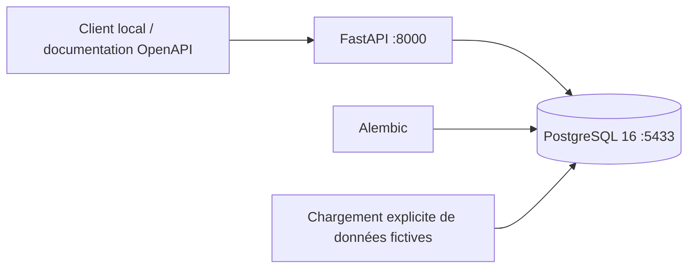

# Architecture ElectionHub V2

Référence : schéma V2 fourni dans la conversation et instructions maître du projet.
Le dossier initial était vide ; aucun schéma ni code antérieur n'était présent sur disque.
Ce document transcrit la référence, sans prétendre remplacer l'image originale.

ElectionHub consulte et consolide des résultats par bureau. Il ne permet aucun vote
électronique et ne stocke aucun choix électoral individuel. Tous les jeux de données
opérationnels de développement sont fictifs et signalés comme tels.

## Acteurs et responsabilités cibles

| Acteur | Accès prévu | Périmètre |
|---|---|---|
| Citoyen | CIN fictive + OTP | Consulter les informations autorisées de son bureau |
| Agent | Compte RBAC | Saisir les résultats des bureaux affectés, déposer PV et incidents |
| Administrateur | Compte RBAC | Gérer comptes, rôles et référentiels, sans contourner la validation |
| Validateur | Compte RBAC | Examiner les PV, approuver ou rejeter avec historique |
| Public / presse | Sans compte | Lire les agrégats publiés dans Looker Studio |

## Répartition des services

| Fournisseur | Services et responsabilités cibles | État en phase 1 |
|---|---|---|
| Cloudflare | HTTPS, WAF, DDoS, CDN devant le portail | Planifié |
| Azure | **Un seul App Service** pour portail React et back-office | Planifié |
| GCP | Load Balancing, API FastAPI sur Compute Engine MIG, Secret Manager | API locale seulement |
| AWS | RDS PostgreSQL transactionnel, S3 privé, Lambda OTP et Lambda PV distinctes, SNS | PostgreSQL local seulement |
| AWS | EC2 pour API de secours compatible | Planifié |
| GCP | BigQuery pour données approuvées, Looker Studio pour publication publique | Planifié |

## Les sept flux

1. **Consultation** : citoyen → Cloudflare → application Azure → Load Balancing GCP
   → API Compute Engine → RDS. L'API applique les droits et consulte les données.
2. **OTP** : API → Lambda OTP → SNS → numéro de test autorisé. L'état temporaire,
   l'expiration, les essais et la vérification sécurisée restent à concevoir.
3. **Secours** : Load Balancing GCP → EC2. Le type de backend, le réseau,
   la supervision et la politique de bascule devront être prouvés par un essai contrôlé.
4. **Secrets** : Compute Engine → Secret Manager, avec identité de service et droits minimaux.
5. **PV / événements** : agent → application Azure → API → S3 → Lambda PV → RDS.
   Le formulaire fournit les résultats structurés ; le document est une pièce justificative.
   Le traitement doit être idempotent et ne vaut jamais approbation humaine.
6. **Publication** : RDS → synchronisation par lots → BigQuery → Looker Studio → public.
   Seule la dernière révision admissible approuvée peut contribuer aux totaux publiés.
7. **Administration / validation** : administrateur ou validateur → Cloudflare →
   application Azure → API → RDS. Les décisions sont autorisées côté API et auditées.

## Points à clarifier avant les phases concernées

- Aucune contradiction sur le nombre d'App Services : **un**, pour toutes les interfaces.
- Le schéma représente le flux de publication mais pas son exécuteur : prévoir un job
  par lots, sa reprise et sa fréquence en phase 8 ; aucun service supplémentaire décidé ici.
- La flèche de secours décrit une intention ; elle ne prouve pas qu'un équilibrage GCP
  standard accepte EC2 ou effectue une bascule automatique. Étude et configuration à valider
  en phase 9, avant toute promesse de résilience.
- Les rôles, portées de validation, révisions, conflits d'affectation et équations de
  cohérence devront être spécifiés avec le modèle métier des phases 2 et 3.
- Les numéros SNS et envois SMS nécessitent une autorisation explicite ; les mocks locaux
  précèdent l'intégration. Aucun SMS ni identifiant citoyen dans cette phase.
- La connectivité privée ou filtrée entre GCP et RDS, le TLS, les identités inter-cloud
  et l'accès d'EC2 aux secrets restent à concevoir avant déploiement.
- La consultation publique de Looker Studio est distincte de la protection Cloudflare.
- La date de synchronisation BigQuery et le rafraîchissement Looker doivent être affichés
  séparément ; aucune garantie de temps réel.

## Périmètre local actuel

Mise à jour phase 3 : le schéma relationnel et les API métier locales comprennent des
PV révisables, des comptes et sessions, un contrôle des rôles côté serveur, et la validation
humaine SUBMITTED → PENDING_VALIDATION → APPROVED / REJECTED. La simulation OTP citoyen
est optionnelle et locale. Aucun S3, Lambda, SNS, BigQuery ni mécanisme de publication
n'est intégré. Voir [le modèle](../database/phase-2.md),
[le schéma de sécurité](../database/phase-3.md) et [les permissions](../api/phase-3.md).

L'environnement local ne simule pas un déploiement multi-cloud réussi. Aucun des sept
flux n'est validé de bout en bout dans le cloud. Les futurs composants React et cloud
seront ajoutés dans leurs phases, sans créer de dossiers vides aujourd'hui.

Mise à jour phase 4 : une seule application React sert maintenant le portail et le
back-office locaux. Elle communique avec FastAPI par un proxy Nginx de même origine et
adapte la navigation aux quatre rôles authentifiés. Cette unité correspond au futur
App Service Azure unique. Voir [le guide frontend](../api/phase-4.md).

Mise à jour AWS-3 : le stockage documentaire S3 privé est qualifié dans `eu-north-1`.
Le plan Terraform adopte ce bucket par import avec `prevent_destroy` et prépare, sans les
créer, un rôle applicatif minimal, un VPC et RDS PostgreSQL 16. La cible RDS reste privée
par défaut ; un endpoint public ne sera envisagé qu'avec une sortie GCP fixe, une règle
`/32` et TLS `verify-full`. Voir le [plan AWS-3](../infrastructure/aws-3-plan.md).
