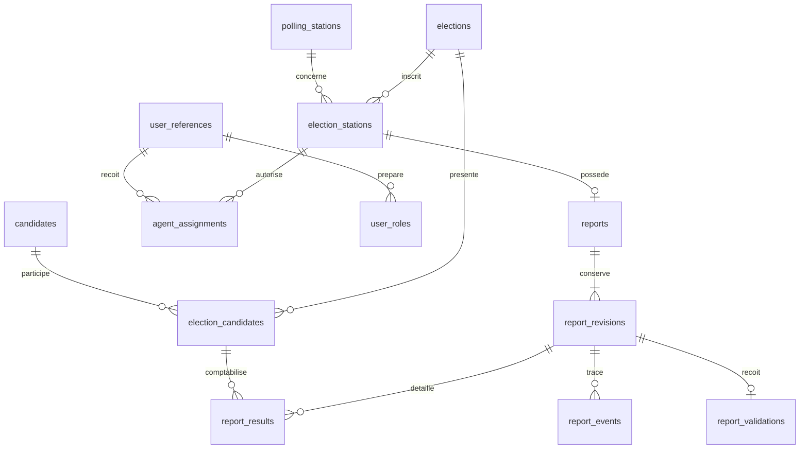

# Modèle relationnel — Phase 2

État : **IMPLÉMENTÉ**, migration `0002_election_domain`, après `0001_polling_stations`.
La migration initiale et ses bureaux existants sont conservés.

| Table | Identité / contraintes | Relations et usage |
|---|---|---|
| `elections` | UUID, code DEMO unique, dates ordonnées | Scrutin synthétique et règle d'égalité des bulletins |
| `polling_stations` | UUID, code unique | Référentiel initial conservé |
| `election_stations` | PK scrutin + bureau, inscrits ≥ 0 | Inscription et nombre d'inscrits propres au scrutin |
| `candidates` | UUID, code DEMO unique | Candidat ou liste fictive, sans données de vote individuel |
| `election_candidates` | PK scrutin + candidat | Participation au scrutin |
| `user_references` | UUID, code DEMO unique, actif | Référence synthétique ; aucun compte authentifiable |
| `user_roles` | PK utilisateur + rôle, valeurs contrôlées | Rôles déclaratifs préparant le futur RBAC |
| `agent_assignments` | PK scrutin + bureau + utilisateur | Affectation à un bureau inscrit au scrutin |
| `reports` | UUID, unique scrutin + bureau | Dossier stable, auteur, numéro de révision courante |
| `report_revisions` | UUID, unique dossier + numéro | Snapshot des résultats et des règles, version d'édition |
| `report_results` | PK révision + candidat, voix ≥ 0 | Résultat agrégé par candidat, jamais bulletin individuel |
| `report_events` | UUID, révision et acteur requis | Trace des créations, saisies, soumissions et corrections |
| `report_validations` | UUID, une décision par révision | Décision humaine future ; motif obligatoire pour rejet |

## Intégrité

Les clés étrangères composites des résultats imposent l'appartenance de la révision et
du candidat au même scrutin. Les FK n'effacent pas les objets métier en cascade.
L'index unique partiel `uq_report_draft` empêche deux brouillons dans le même dossier.
La contrainte dossier/numéro empêche une révision dupliquée ; le couple scrutin/bureau
empêche plusieurs dossiers concurrents. Les index de PK/UNIQUE servent aux recherches
et aux jointures ; les index de statut et d'événements servent aux files et historiques.

Les compteurs sont des INTEGER PostgreSQL non négatifs, limités à 2 147 483 647.
La somme intermédiaire des bulletins utilise BIGINT dans le CHECK pour éviter le
dépassement arithmétique. Les dates d'événement sont `TIMESTAMP WITH TIME ZONE`, exposées
en UTC ; le numéro de révision et la version d'édition ordonnent les événements même si
plusieurs événements d'une transaction ont le même horodatage.

La somme des voix par candidat est une contrainte multi-lignes vérifiée dans le service
métier sous verrou transactionnel, à la saisie et à la soumission. Ce n'est pas un CHECK
SQL multi-lignes. Une intervention SQL privilégiée peut contourner le workflow : les
comptes d'exécution restreints et permissions de production restent à configurer plus tard.

## Révisions et cycle de vie

**IMPLÉMENTÉ** : création DRAFT, remplacement complet des résultats, DRAFT → SUBMITTED,
correction d'un SUBMITTED/REJECTED/PROCESSING_FAILED en nouvelle révision DRAFT.
L'ancienne révision conserve résultats, statut, événements et éventuelle décision.
Le dossier contient `current_revision`, et cette sélection sera obligatoire pour les
futurs traitements. Ne jamais sommer toutes les lignes de `report_revisions`.

**PLANIFIÉ** : SUBMITTED → PROCESSING → PENDING_VALIDATION, échecs de traitement,
APPROVED/REJECTED par validateur authentifié, PUBLISHED après synchronisation contrôlée.
Les corrections d'une version approuvée/publiée sont bloquées en phase 2. Le cycle précis
de retrait et de republication devra être conçu avant d'activer ces corrections.

Le brouillon initial peut être vide. Une saisie PUT constitue un jeu complet et cohérent :
tous les candidats exactement une fois, somme égale aux voix valides, participation bornée.
L'égalité voix valides + blancs + nuls = déposés est activée par défaut, configurable avant
le premier dossier du scrutin. Chaque composante reste bornée par les bulletins déposés.
Référentiels et affectations sont figés dès le premier dossier pour simplifier ce jalon.

## Preuves

**TESTÉ** : migrations upgrade/downgrade/upgrade sur schémas isolés, conservation d'une
ligne phase 1, concordance Alembic/modèles, contraintes SQL, relations ORM, FK composites,
concurrence de création et d'édition, révision après rejet sans perte de décision.
Voir [rapport phase 2](../testing/phase-2.md).
